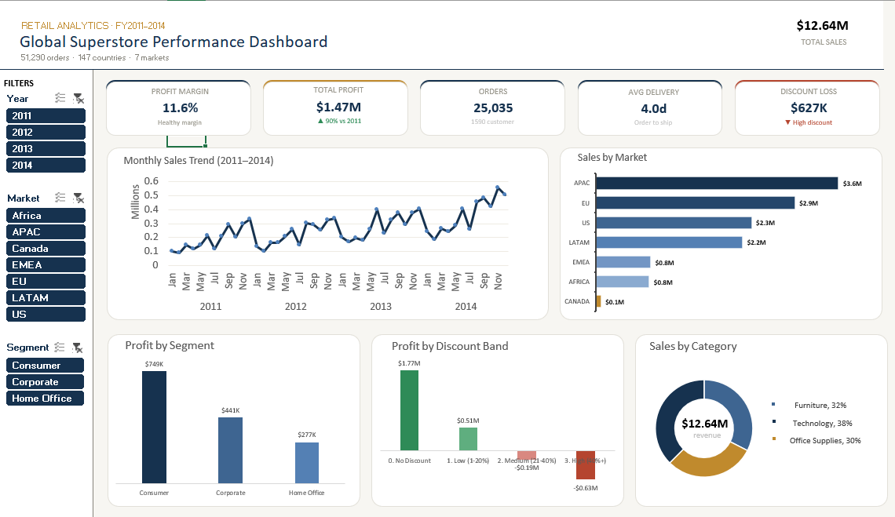

# Global Superstore — Sales & Profitability Analytics

An end-to-end retail analytics project analyzing **51,290 transactions** across
**147 countries** over four years (2011–2014) — built entirely in Excel using
Power Pivot, DAX measures, and interactive dashboards.

---

## 🎯 The Key Finding

While the business grew sales by **90%** over four years, a hidden problem
was draining profit:

> **Discounts above 20% turned profit into loss — costing the company $814K.**

| Discount Band | Profit / (Loss) |
|---------------|-----------------|
| No Discount | +$1,770,695 |
| Low (1–20%) | +$511,444 |
| Medium (21–40%) | **-$187,271** |
| High (40%+) | **-$627,411** |

---

## 📊 Business Metrics

| Metric | Value |
|--------|-------|
| Total Sales | $12.64M |
| Net Profit | $1.47M |
| Profit Margin | 11.6% |
| Distinct Orders | 25,035 |
| Customers | 1,590 |
| Countries | 147 |

---

## 🔑 Key Insights

- **Discounting is the #1 profit leak** — 21%+ discount bands lost $814K combined
- **Canada is the hidden margin champion** — 27% margin vs 11.6% company average
- **Tables is the only loss-making sub-category** — lost $64K, needs review
- **APAC & EU drive 52% of sales** — the twin growth engines
- **Consumer segment leads profit** — $749K (51% of total)

---

## 🛠️ Tools & Techniques

- **Excel Power Pivot** — data model for 51K+ rows
- **DAX Measures** — `DIVIDE(SUM(Profit), SUM(Sales))` for accurate margins
- **DISTINCTCOUNT** — correct order & customer counts (not row counts)
- **Interactive Slicers** — Year / Market / Segment filters connected to all visuals
- **Diverging Column Chart** — exposing profit-vs-loss discount bands
- **5 Calculated Columns** — Year, Month-Year, Profit Margin, Discount Band, Shipping Days

---

## 📁 Repository Contents

| File | Description |
|------|-------------|
| `Global_Superstore_Dashboard.xlsx` | Full workbook — data, pivots, DAX measures & dashboard |
| `Global_Superstore_Case_Study.pdf` | 6-page executive case study with recommendations |
| `dashboard_preview.png` | Dashboard screenshot |

---

## 📈 Dashboard Features

- **6 KPI cards** with DAX-driven, slicer-connected metrics
- **Monthly sales trend** (48 months, 2011–2014)
- **Sales by market** — navy gradient with margin-leader highlight
- **Category mix** donut chart
- **Profit by segment** & **discount impact** (diverging)
- **Left-panel slicers** for interactive filtering

---

## 💡 Strategic Recommendations

1. **Institute a 20% discount ceiling** — target the $814K loss zone
2. **Fix or exit the Tables sub-category** — stop the $64K annual drag
3. **Invest in Canada & high-margin markets** — scale the proven 27% model
4. **Prioritise the Consumer segment** — protect 51% of total profit

---

## 📂 Dataset

**Source:** Global Superstore Dataset
**Size:** 51,290 rows × 24 columns
**Period:** 2011–2014

---

## 👤 Author

**Ranjan Sah** — Data Analyst
📍 Bihar, India | Open to Data Analyst opportunities

🔗 [LinkedIn]([https://www.linkedin.com/in/ranjan-sah?utm_source=share_via&utm_content=profile&utm_medium=member_android]